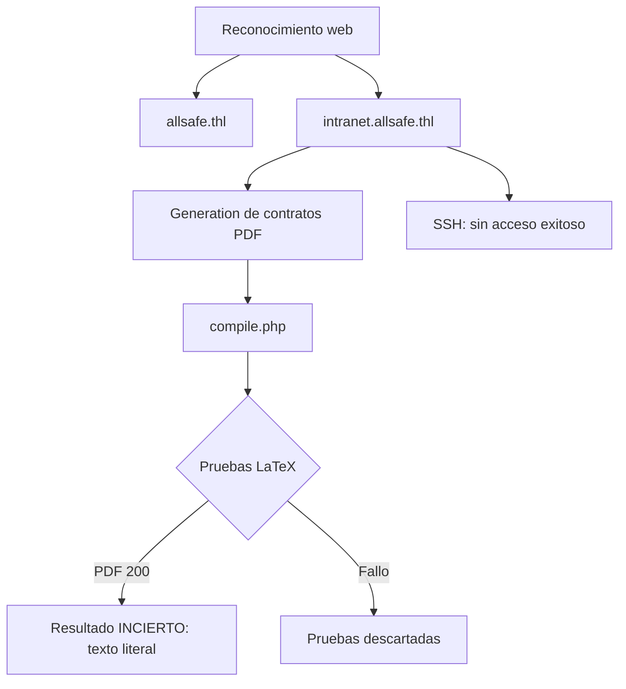

# AllSafe — Roadmap (parcial, en progreso)

> [!warning] Roadmap incompleto
> No hay cadena de explotación confirmada. Se distinguen **hipótesis**, **payload enviado**, **respuesta obtenida**, **resultado real** y **próxima prueba**.

## Lo confirmado

## Etapas verificadas

### 1. Reconocimiento web
- **Objetivo:** identificar superficie.
- **Evidencia que permite avanzar:** dos dominios, `allsafe.thl` e `intranet.allsafe.thl`.

### 2. Intranet y generación de contratos
- **Objetivo:** entender la funcionalidad.
- **Evidencia:** formularios que generan **contratos PDF**; proceso `compile.php`.

### 3. Pruebas LaTeX (inconcluyentes)
- **Objetivo:** lograr lectura de ficheros / ejecución vía LaTeX.
- **Evidencia:** se probaron entradas LaTeX, incluida `\lstinputlisting`.
- **Resultado real:** se generan PDFs (HTTP 200) pero **algunas entradas salen como texto literal**; otras fallaron.
- **Conclusión honesta:** 🔴 **LFI/ejecución LaTeX NO confirmados.** Un HTTP 200 no prueba explotación.

## Bloqueo actual

- No se ha demostrado lectura de un fichero fuera de lo previsto ni ejecución de comandos.

## Próximos pasos

Ver [[AllSafe - Pendientes]].

## Enlaces

- [[AllSafe - Walkthrough]]
- [[AllSafe - Evidencias]]
- [[AllSafe - Pendientes]]
