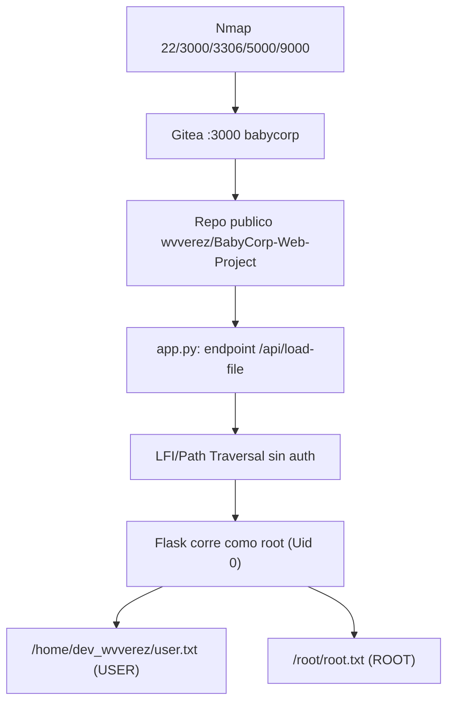

# BabyCorp — Roadmap

> [!abstract] Cadena de explotación
> Nmap → **Gitea con repo público** `wvverez/BabyCorp-Web-Project` → fuga de `app.py` → **LFI/Path Traversal** en `POST /api/load-file` → el servicio Flask **corre como root** → lectura arbitraria como root → **user** y **root flags**.

## Diagrama



## Etapas

### 1. Reconocimiento
- **Objetivo:** superficie de la máquina.
- **Evidencia que permite avanzar:** puertos `22, 3000 (Gitea), 3306 (MariaDB), 5000 (Flask), 9000 (custom)`.
- **Decisión:** la presencia de Gitea orienta a buscar **fuga de código**.

### 2. Gitea → fuga de código
- **Objetivo:** obtener el código de la web.
- **Evidencia:** repositorio **público** `wvverez/BabyCorp-Web-Project`, clonable sin credenciales.
- **Decisión:** leer `app.py` para localizar el **sink** en vez de auditar a ciegas.

### 3. LFI en `POST /api/load-file`
- **Objetivo:** leer ficheros arbitrarios.
- **Evidencia:** el endpoint abre `filename` **sin validación ni autenticación** y devuelve el contenido.
- **Decisión:** usar `curl --data-urlencode` y decodificar [[Base64]].

### 4. Escalada "gratis" a root
- **Objetivo:** conseguir privilegios.
- **Evidencia:** `/proc/self/status` muestra `Uid: 0` → el servicio corre como **root**.
- **Decisión:** el LFI ya es lectura arbitraria **como root**: no hace falta más escalada.

## Kill chain resumida

```text
nmap → Gitea repo público → app.py → LFI /api/load-file → Flask como root
  → /home/dev_wvverez/user.txt (USER) → /root/root.txt (ROOT)
```

## Enlaces

- [[BabyCorp - Walkthrough]]
- [[BabyCorp - Evidencias]]
- [[BabyCorp - Pendientes]]
