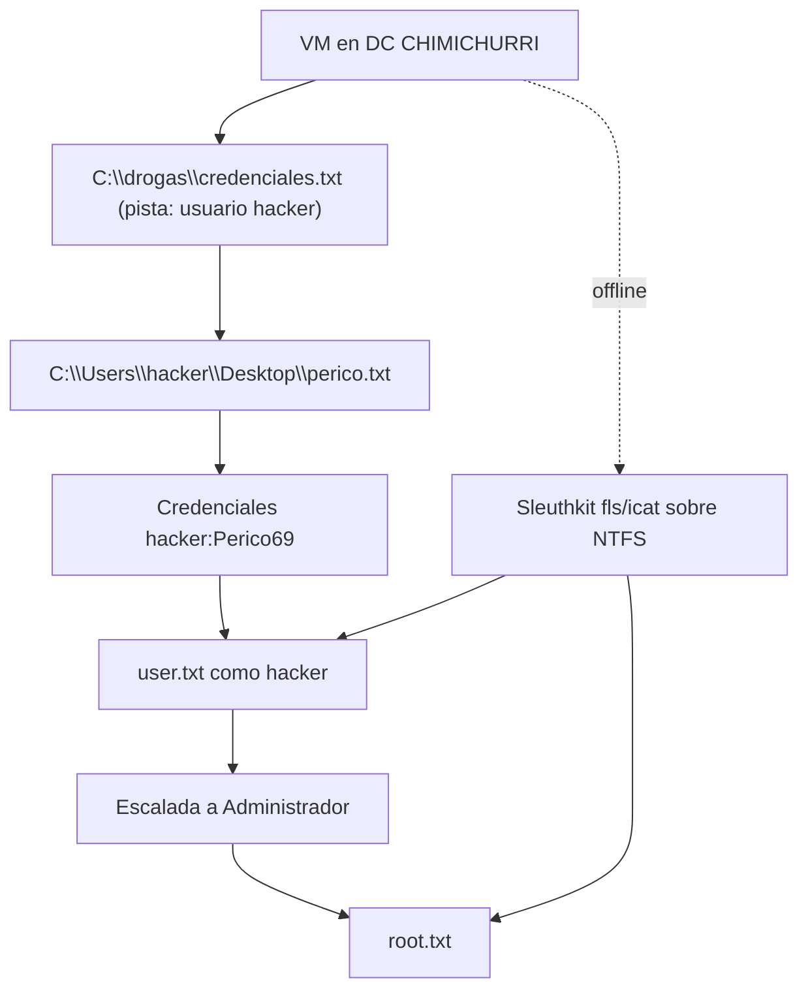

# Chimichurri — Roadmap

> [!abstract] Cadena de explotación
> Pista en `C:\drogas\credenciales.txt` → usuario **hacker** → credenciales `hacker:Perico69` en `perico.txt` → lectura de `user.txt` → escalada a **Administrador** → `root.txt`.

## Diagrama



## Etapas

### 1. Entorno / acceso al sistema de ficheros
- **Objetivo:** disponer de los ficheros del DC.
- **Evidencia:** pista en `C:\drogas\credenciales.txt`.
- **Decisión:** seguir las pistas en disco (y/o lectura offline con sleuthkit).

### 2. Credenciales y acceso como `hacker`
- **Objetivo:** obtener un login válido.
- **Evidencia:** `perico.txt` → **`hacker:Perico69`**.
- **Decisión:** usar credenciales halladas en ficheros antes de atacar AD.

### 3. User flag
- **Objetivo:** leer `user.txt`.
- **Evidencia:** `C:\Users\hacker\Desktop\user.txt`.

### 4. Escalada a Administrador
- **Objetivo:** root.
- **Evidencia:** `C:\Users\Administrador\Desktop\root.txt`.

## Problemas de entorno (resueltos)

| Problema | Solución |
|---|---|
| VM sin lease DHCP / APIPA | Reparar DHCP de VirtualBox (`192.168.56.2`) |
| `NS_ERROR_FAILURE` por UUID de disco distinto | `VBoxManage internalcommands sethduuid "<vdi>" c9fd0695-6ab4-4e18-8c7f-443d746f1a65` |

## Kill chain resumida

```text
DC CHIMICHURRI → C:\drogas\credenciales.txt (hacker) → perico.txt (Perico69)
  → user.txt (hacker) → escalada Administrador → root.txt
```

## Enlaces

- [[Chimichurri - Walkthrough]]
- [[Chimichurri - Evidencias]]
