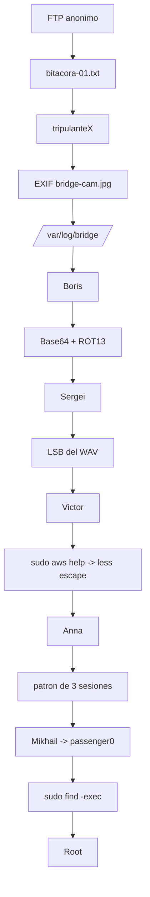

# Cold Fear — Roadmap

> [!abstract] Cadena de explotación
> FTP anónimo → `bitacora-01.txt` → `tripulanteX` → análisis **EXIF** de `bridge-cam.jpg` → `/var/log/bridge/` → pistas de **Boris** → **Base64 + ROT13** → **Sergei** → análisis **LSB del WAV** → **Victor** → `sudo aws help` → escape del pager `less` → **Anna** → patrón de **tres sesiones** → **Mikhail** → **passenger0** → `sudo find -exec` → **root**.

## Diagrama



## Etapas

### 1. Reconocimiento
- **Objetivo:** identificar servicios.
- **Evidencia que permite avanzar:** `21 (FTP)`, `22 (SSH)`, `80 (HTTP)`.

### 2. FTP anónimo → bitácora → `tripulanteX`
- **Objetivo:** acceder sin credenciales.
- **Evidencia:** `bitacora-01.txt` menciona a `tripulanteX`.
- **Decisión:** probar FTP anónimo antes de fuerza bruta.

### 3. EXIF + imagen → `/var/log/bridge/` → Boris
- **Objetivo:** extraer pistas ocultas en metadatos.
- **Evidencia:** `exiftool bridge-cam.jpg` y **comparación de imágenes** revelan la ruta `/var/log/bridge/` y pistas de Boris.
- **Decisión:** combinar metadatos con el contenido de la imagen (comparar original vs. modificada).

### 4. Base64 + ROT13 → Sergei
- **Objetivo:** decodificar el mensaje.
- **Evidencia:** cadena codificada en Base64 que, tras decodificar, está en ROT13.
- **Decisión:** encadenar decodificaciones en el orden correcto.

### 5. LSB del WAV → Victor
- **Objetivo:** extraer datos ocultos en audio.
- **Evidencia:** reconstrucción de **2 bits LSB** del PCM produce un mensaje con `Victor`.
- **Decisión:** analizar el audio en crudo (PCM) en vez de solo metadatos.

### 6. `sudo aws help` → escape del pager `less` → Anna
- **Objetivo:** ejecutar comandos vía un programa permitido en `sudo`.
- **Evidencia:** `sudo aws help` abre `less`; desde `less` (`!sh`) se escapa a shell.
- **Decisión:** usar [[GTFOBins]] para el escape del pager.

### 7. Patrón de tres sesiones → Mikhail → passenger0
- **Objetivo:** reconstruir la contraseña a partir de un patrón.
- **Evidencia:** la pista describe un patrón de **tres sesiones** que da la contraseña de Mikhail.
- **Decisión:** reconstruir la contraseña por lógica, no por fuerza bruta.

### 8. `sudo find -exec` → root
- **Objetivo:** escalada final.
- **Evidencia:** `passenger0` puede `sudo find` con `-exec` → `sudo find . -exec /bin/sh \; -quit`.
- **Decisión:** GTFOBins para `find`.

## Kill chain resumida

```text
FTP anon → bitacora → tripulanteX → EXIF → /var/log/bridge → Boris
  → Base64+ROT13 → Sergei → WAV LSB → Victor → sudo aws (less escape) → Anna
  → patron 3 sesiones → Mikhail → passenger0 → sudo find -exec → root
```

## Enlaces

- [[Cold Fear - Walkthrough]]
- [[Cold Fear - Evidencias]]
- [[Cold Fear - Lecciones]]
- [[Cold Fear - Defensas]]
