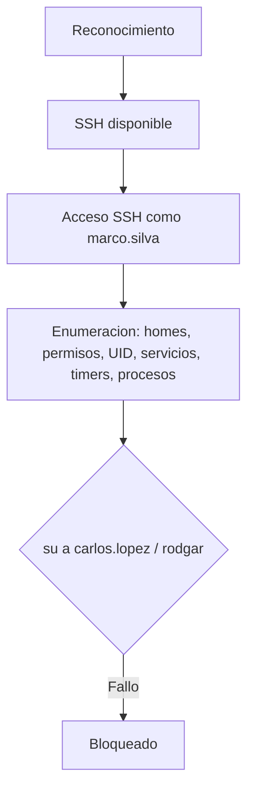

# Company1 — Roadmap (parcial, en progreso)

> [!warning] Roadmap incompleto
> No hay cadena de explotación confirmada. Este documento recoge lo **verificado** y lo **pendiente**. Ver [[Company1 - Pendientes]].

## Lo confirmado

## Etapas verificadas

### 1. Reconocimiento
- **Objetivo:** superficie de la máquina.
- **Evidencia que permite avanzar:** servicio **SSH** disponible.

### 2. Acceso SSH como `marco.silva`
- **Objetivo:** acceso inicial.
- **Evidencia:** acceso SSH documentado.

### 3. Enumeración post-acceso
- **Objetivo:** encontrar vectores de escalada.
- **Evidencia:** se revisan **homes, permisos, UID, servicios, timers, procesos y archivos**.
- **Decisión:** probar `su` a otras cuentas → **falló**.

## Bloqueo actual

- No se logró escalada; `su` a `carlos.lopez` y `rodgar` **falló**.

## Próximos pasos

Ver [[Company1 - Pendientes]] (hipótesis priorizadas y comandos no destructivos).

## Enlaces

- [[Company1 - Walkthrough]]
- [[Company1 - Evidencias]]
- [[Company1 - Pendientes]]
