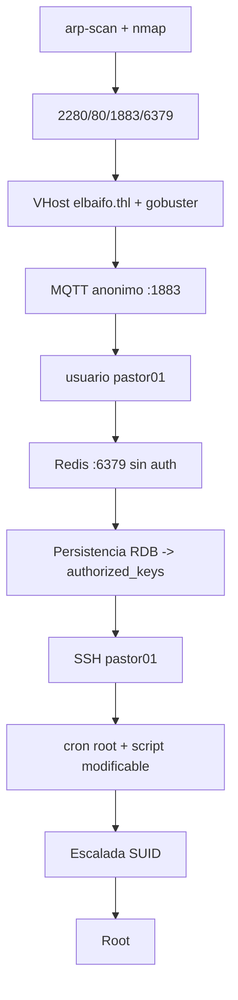

# El Baifo — Roadmap

> [!abstract] Cadena de explotación
> Nmap → web/VHost `elbaifo.thl` → **MQTT anónimo** filtra el usuario `pastor01` → **Redis sin auth** → persistencia RDB → escritura de `authorized_keys` → **SSH como `pastor01`** → cron ejecutado por root con script modificable → **escalada SUID** → root.

## Diagrama



## Etapas

### 1. Reconocimiento
- **Objetivo:** descubrir el host y sus servicios.
- **Evidencia que permite avanzar:** puertos `22, 80, 1883 (MQTT), 6379 (Redis)`.
- **Decisión / alternativa:** se usa `arp-scan` para el descubrimiento y Nmap para el detalle.

### 2. Web / Virtual host
- **Objetivo:** encontrar el sitio y su vhost.
- **Evidencia que permite avanzar:** `Gobuster` + resolución de `elbaifo.thl` en `/etc/hosts`.
- **Decisión / alternativa:** probar el vhost antes de atacar MQTT, porque el nombre del dominio ya da contexto.

### 3. MQTT anónimo → usuario `pastor01`
- **Objetivo:** leer la telemetría publicada sin credenciales.
- **Evidencia que permite avanzar:** `mosquitto_sub` recibe mensajes que mencionan el usuario `pastor01`.
- **Decisión / alternativa:** probar el broker sin credenciales es de bajo coste y alto valor.

### 4. Redis sin autenticación → `authorized_keys`
- **Objetivo:** escribir un fichero arbitrario como el usuario que corre Redis.
- **Evidencia que permite avanzar:** `redis-cli` sin `AUTH` permite `CONFIG SET dir`/`dbfilename` y `SAVE`.
- **Decisión / alternativa:** se elige escribir `~/.ssh/authorized_keys` en lugar de un `cron` (más simple y directo).

### 5. SSH como `pastor01` → user flag
- **Objetivo:** acceso estable.
- **Evidencia que permite avanzar:** clave privada propia aceptada por el `authorized_keys` escrito.
- **Decisión / alternativa:** guardar la clave y usarla solo en el laboratorio.

### 6. Cron root + script modificable → SUID → root
- **Objetivo:** escalar.
- **Evidencia que permite avanzar:** el script que ejecuta el cron de root es **escribible** por `pastor01`; el SUID aparece/usa binario explotable.
- **Decisión / alternativa:** modificar el script esperando la siguiente ejecución del cron; verificar `EUID` con `id`.

## Kill chain resumida

```text
arp-scan/nmap → vhost elbaifo.thl → MQTT anon (pastor01) → Redis sin auth
  → authorized_keys → SSH pastor01 → cron root + script escribible → SUID → root
```

## Enlaces

- [[El Baifo - Walkthrough]]
- [[El Baifo - Evidencias]]
- [[El Baifo - Lecciones]]
- [[El Baifo - Defensas]]
