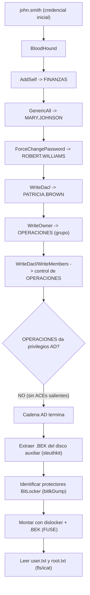

# Elevator — Roadmap (resumen)

> [!tip] Documento principal
> El detalle completo está en [[Elevator - Roadmap]]. Esta nota resume la cadena y añade el diagrama.

> [!abstract] Cadena de explotación
> Autenticación como `john.smith` → recolección **BloodHound** → cadena de **ACLs** hasta controlar `OPERACIONES` (que **no** da privilegios AD) → extraer `.BEK` del disco auxiliar → identificar protectores **BitLocker** → montar con **dislocker** → leer las flags.

## Diagrama



## Kill chain resumida

```text
john.smith → BloodHound → AddSelf→FINANZAS → GenericAll→MARY → ForceChangePassword→ROBERT
  → WriteDacl→PATRICIA → WriteOwner→OPERACIONES → (sin privilegios AD)
  → .BEK del disco auxiliar → bitlkDump → dislocker → flags (USER/ROOT)
```

## Nota clave

> [!warning] La cadena AD engaña
> BloodHound es una **guía**, no una garantía. Hay que validar las **DACLs reales** (`nTSecurityDescriptor` + control `SD_FLAGS`): no toda cadena de ACL llega a DCSync.

## Enlaces

- [[Elevator - Roadmap]] (detalle completo)
- [[Elevator - Walkthrough]]
- [[Elevator - Evidencias]]
