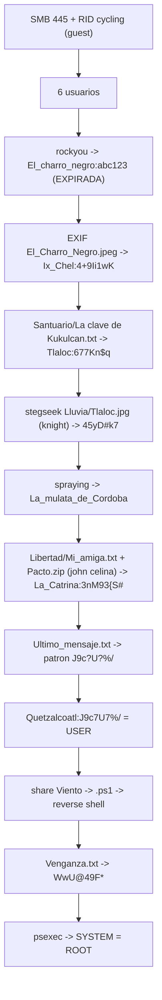

# Folclore — Roadmap (resumen)

> [!tip] Documento principal
> El detalle completo está en [[Folclore - Roadmap]]. Esta nota resume la cadena y añade el diagrama.

> [!abstract] Cadena de explotación
> SMB + RID cycling → 6 usuarios → `rockyou` → `El_charro_negro:abc123` (EXPIRADA) → **EXIF** de `El_Charro_Negro.jpeg` → `Ix_Chel:4+9Ii1wK` → `Santuario/La clave de Kukulcán.txt` → `Tlaloc:677Kn$q` → **stegseek** sobre `Lluvia/Tlaloc.jpg` (passphrase `knight`) → `45yD#k7` → spraying → `La_mulata:45yD#k7` → `Libertad/Mi_amiga.txt` + `Pacto.zip` (john `celina`) → `La_Catrina:3nM93{S#` → `"Dia de Muertos"/Ultimo_mensaje.txt` → patrón `J9c?U?%/` → `Quetzalcoatl:J9c7U7%/` (**USER**) → share `Viento` → subir `.ps1` → reverse shell → `Venganza.txt` (`WwU@49F*`) → `psexec` → SYSTEM (**ROOT**).

## Diagrama



## Kill chain resumida

```text
SMB/RID cycling → 6 users → rockyou → El_charro_negro (EXPIRADA) → EXIF → Ix_Chel
  → Santuario txt → Tlaloc → stegseek (knight) → spraying → La_mulata
  → Pacto.zip (celina) → La_Catrina → patron J9c?U?%/ → Quetzalcoatl (USER)
  → share Viento .ps1 → rev shell → Venganza.txt → psexec → SYSTEM (ROOT)
```

## Enlaces

- [[Folclore - Roadmap]] (detalle completo)
- [[Folclore - Walkthrough]]
- [[Folclore - Evidencias]]
