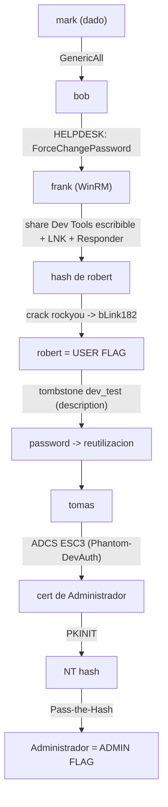

# Phantom — Roadmap (resumen)

> [!tip] Documento principal
> El detalle completo está en [[Phantom - Roadmap]] (writeup paso a paso). Esta nota ofrece el **resumen** y el diagrama.

> [!abstract] Cadena de explotación
> `mark` →(GenericAll)→ `bob` →(HELPDESK ForceChangePassword)→ `frank` (WinRM) → LNK en share "Dev Tools" + Responder → hash de `robert` → crack (bLink182) → **USER** → tombstone `dev_test` (password en `description`) → reutilización → `tomas` → **ADCS ESC3** (Phantom-DevAuth) → cert de Administrador → **PKINIT** → NT hash → **PtH** → **ADMIN**.

## Diagrama



## Kill chain resumida

```text
mark —GenericAll→ bob —ForceChangePassword→ frank (WinRM)
  → LNK + Responder → hash robert → crack → robert (USER FLAG)
  → tombstone dev_test → tomas → ADCS ESC3 → cert Administrador
  → PKINIT → NT hash → PtH → ADMIN FLAG
```

## Enlaces

- [[Phantom - Roadmap]] (detalle completo)
- [[Phantom - Walkthrough]]
- [[Phantom - Evidencias]]
