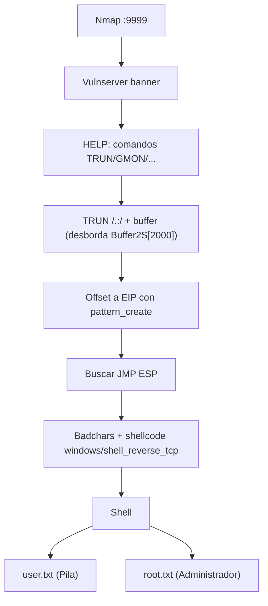

# Pila — Roadmap

> [!abstract] Cadena de explotación
> Escaneo del puerto `9999` → **Vulnserver** → comando `TRUN /.:/` desborda `Buffer2S[2000]` → **offset a EIP** → `JMP ESP` → shellcode → shell → leer `user.txt` y `root.txt`.

## Diagrama



## Etapas

### 1. Reconocimiento
- **Objetivo:** identificar el servicio.
- **Evidencia:** puerto `9999` = `vulnserver`.
- **Decisión:** enumerar comandos con `HELP`.

### 2. Análisis de la vulnerabilidad
- **Objetivo:** localizar el desbordamiento.
- **Evidencia:** `Function3()` usa `char Buffer2S[2000]; strcpy(Buffer2S, Input);` → comandos `TRUN`/`GMON` desbordan.
- **Decisión:** usar `TRUN /.:/` (patrón conocido) para controlar EIP.

### 3. Cálculo de offset y control de EIP
- **Objetivo:** conocer el desplazamiento exacto.
- **Evidencia:** `msf-pattern_create`/`pattern_offset`.
- **Decisión:** encontrar un `JMP ESP` estable (sin ASLR en Server 2008).

### 4. Shellcode y shell
- **Objetivo:** ejecución de código.
- **Evidencia:** `windows/shell_reverse_tcp` tras filtrar badchars.
- **Decisión:** ajustar NOPs/prefijos (`TRUN /.:/`) según el comando.

### 5. Extracción de flags
- **Objetivo:** leer las flags.
- **Evidencia:** `user.txt` y `root.txt`; también lectura **offline** del NTFS.
- **Decisión:** alternativa válida (documentada) con `fls`/`icat` sin explotar.

## Kill chain resumida

```text
nmap :9999 → vulnserver → TRUN overflow → offset EIP → JMP ESP → shellcode → shell
  → user.txt (Pila) → root.txt (Administrador)
```

## Enlaces

- [[Pila - Walkthrough]]
- [[Pila - Evidencias]]
