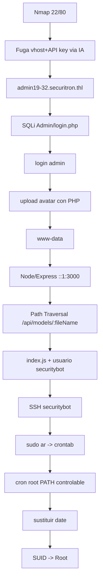

# Securitron — Roadmap

> [!abstract] Cadena de explotación
> Nmap → **fuga de vhost y API key desde una IA** → `admin19-32.securitron.thl` → **SQL Injection** en `Admin/login.php` → login admin → **subida de avatar con PHP incrustado** → `www-data` → **API Node/Express interna por IPv6 `::1:3000`** → **path traversal** en `/api/models/:fileName` → lectura de `index.js` y pista de usuario → **SSH como `securitybot`** → **`sudo ar`** para leer crontab → cron root con ruta en `PATH` → **sustitución de `date`** → escalada **SUID** → root.

## Diagrama



## Etapas

### 1. Reconocimiento + fuga de info
- **Objetivo:** obtener hosts/credenciales.
- **Evidencia:** una aplicación con **IA** filtra el **vhost** y una **API key**.
- **Decisión:** explotar la fuga en vez de fuerza bruta.

### 2. SQLi en el login → admin
- **Objetivo:** entrar como administrador.
- **Evidencia:** `Admin/login.php` vulnerable a **SQLi** (boolean y time-based).
- **Decisión:** usar time-based cuando las respuestas no difieren visiblemente.

### 3. File upload con PHP → `www-data`
- **Objetivo:** RCE.
- **Evidencia:** la subida de **avatar** permite incrustar PHP (validación MIME evitable).
- **Decisión:** probar variantes de extensión/MIME.

### 4. API Node/Express interna (`::1:3000`) → path traversal
- **Objetivo:** leer código y obtener un usuario.
- **Evidencia:** `/api/models/:fileName` permite **path traversal**; se lee `index.js` y una pista de usuario.
- **Decisión:** recordar que `localhost` **IPv6** (`::1`) es distinto de `127.0.0.1`; usar `curl --path-as-is`.

### 5. SSH `securitybot` → `sudo ar` → crontab
- **Objetivo:** ver tareas de root.
- **Evidencia:** `sudo ar` permite **leer** ficheros arbitrarios empaquetándolos → crontab de root.
- **Decisión:** [[Sudo-Ar]] para exfiltrar el crontab.

### 6. PATH hijacking en cron → SUID → root
- **Objetivo:** escalada.
- **Evidencia:** el cron de root invoca `date` (u otro binario) con una ruta **controlable** vía `PATH`; se sustituye y se escala.
- **Decisión:** [[Path-Hijacking]] + verificación `EUID`.

## Kill chain resumida

```text
IA leak(vhost+apikey) → SQLi login → upload PHP → www-data → Node ::1:3000
  → path traversal → securitybot → sudo ar (crontab) → PATH hijack (date) → root
```

## Enlaces

- [[Securitron - Walkthrough]]
- [[Securitron - Evidencias]]
- [[Securitron - Lecciones]]
- [[Securitron - Defensas]]
