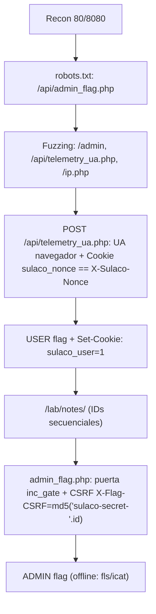

# Sulaco — Roadmap

> [!abstract] Cadena de explotación
> Fuzzing → `/admin` (panel), `/api/telemetry_ua.php`, `/api/admin_flag.php`, `/ip.php` → **USER flag** con `POST /api/telemetry_ua.php` (UA de navegador + doble-submit de nonce cookie==header) → cookie `sulaco_user=1` → `/lab/notes/` → **escalada** obteniendo la admin flag (embebida en `admin_flag.php`, protegida por puerta `inc_gate.php` + CSRF).

## Diagrama



## Etapas

### 1. Reconocimiento
- **Objetivo:** superficie web.
- **Evidencia:** puertos `80` y `8080`; `robots.txt` revela `/api/admin_flag.php`.
- **Decisión:** hacer fuzzing dirigido a partir de `robots.txt`.

### 2. Descubrimiento de endpoints
- **Objetivo:** encontrar funciones.
- **Evidencia:** `/admin`, `/api/telemetry_ua.php`, `/api/admin_flag.php`, `/ip.php`.

### 3. User flag (telemetría)
- **Objetivo:** obtener la flag de usuario.
- **Evidencia:** `POST /api/telemetry_ua.php` requiere **UA de navegador** (curl bloqueado) y **doble-submit** (`Cookie sulaco_nonce` == `X-Sulaco-Nonce`, N aleatorio `openssl rand -hex 16`).
- **Resultado:** `{"flag":"...","type":"user_flag"}` + `Set-Cookie: sulaco_user=1`.

### 4. Escalada a admin
- **Objetivo:** admin flag.
- **Evidencia:** `/lab/notes/` desbloqueada por `sulaco_user=1`; la admin flag está embebida en `admin_flag.php`, protegida por `inc_gate.php` (`sulaco_is_unlocked()`) y CSRF `X-Flag-CSRF: md5('sulaco-secret-'.$id)`.
- **Decisión:** obtener por **lectura offline** del disco (`fls`/`icat`).

## Kill chain resumida

```text
recon(80/8080) → robots.txt → fuzzing (admin, telemetry_ua, admin_flag, ip)
  → POST telemetry_ua (UA+nonce doble-submit) → USER + sulaco_user=1
  → /lab/notes → admin_flag (gate + CSRF) → ADMIN flag (offline)
```

## Problema de entorno (resuelto)

| Problema | Solución |
|---|---|
| VM en **bridged sobre wlan0**, no en host-only | `VBoxManage controlvm "The Hackers Labs - Sulaco" nic1 hostonly vboxnet0` + reinicio → cogió `192.168.56.101` por DHCP |

## Enlaces

- [[Sulaco - Walkthrough]]
- [[Sulaco - Evidencias]]
