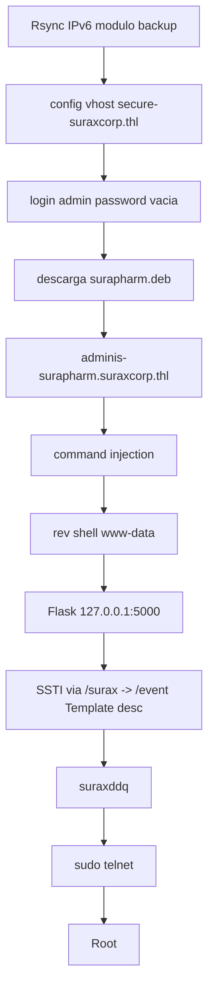

# SuraxCorp — Roadmap

> [!abstract] Cadena de explotación
> **Rsync por IPv6** → módulo `backup` → config de vhost → `secure-suraxcorp.thl` → **login admin con contraseña vacía** → descarga de `surapharm.deb` → inspección del paquete → `adminis-surapharm.suraxcorp.thl` → **command injection** → reverse shell `www-data` → Flask interno `127.0.0.1:5000` → **SSTI** vía `/surax` → `/event` (`Template(description)`) → ejecución como `suraxddq` → `sudo telnet` → **root**.

## Diagrama



## Etapas

### 1. Rsync por IPv6 → módulo `backup`
- **Objetivo:** listar módulos y contenidos compartidos.
- **Evidencia:** el módulo `backup` contiene un **archivo de configuración de virtual host**.
- **Decisión:** atacar Rsync por IPv6 (no siempre escaneado) en vez de solo la web.

### 2. Vhost → login administrativo con contraseña vacía
- **Objetivo:** entrar al panel.
- **Evidencia:** `secure-suraxcorp.thl` con login administrativo que acepta **contraseña vacía**.
- **Decisión:** probar credenciales triviales antes de fuerza bruta.

### 3. `.deb` → `adminis-surapharm.suraxcorp.thl` → command injection
- **Objetivo:** encontrar un punto de ejecución.
- **Evidencia:** inspeccionar `surapharm.deb` revela el vhost `adminis-surapharm…` vulnerable a **command injection** (con filtros).
- **Decisión:** se usan `wildcards`, `${IFS}` y operadores shell para sortear filtros.

### 4. Reverse shell `www-data` → Flask interno
- **Objetivo:** acceso y enumeración interna.
- **Evidencia:** hay un servicio Flask en `127.0.0.1:5000` no expuesto.
- **Decisión:** enumerar localhost (no solo lo expuesto).

### 5. SSTI vía `/surax` → `/event` → `suraxddq`
- **Objetivo:** RCE como el usuario del servicio.
- **Evidencia:** `/event` procesa `description` con `Template(description)` → **SSTI Jinja2**; el **traceback de Werkzeug** confirma la ruta.
- **Decisión:** habilitar la ruta SSTI mediante `/surax` y explotar `/event`.

### 6. `sudo telnet` → root
- **Objetivo:** escalada final.
- **Evidencia:** `sudo -l` muestra `telnet`; `telnet` permite escapar a shell (`!/bin/sh`).
- **Decisión:** [[Sudo-Telnet]].

## Kill chain resumida

```text
rsync(IPv6)/backup → vhost config → panel pass vacía → deb → command injection
  → www-data → Flask :5000 → SSTI /surax→/event → suraxddq → sudo telnet → root
```

## Enlaces

- [[SuraxCorp - Walkthrough]]
- [[SuraxCorp - Evidencias]]
- [[SuraxCorp - Lecciones]]
- [[SuraxCorp - Defensas]]
