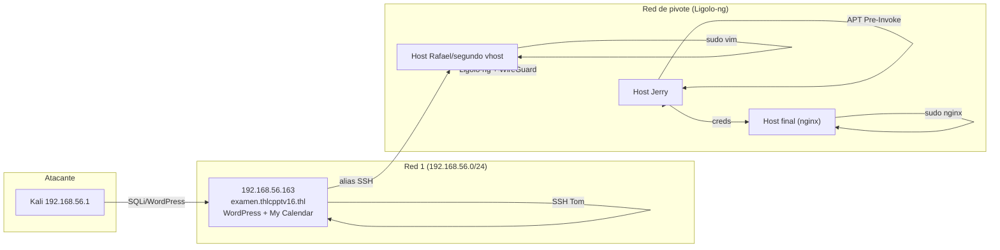

# THLCPPTV16 — Roadmap

> [!abstract] Cadena de explotación
> WordPress + **My Calendar** → **SQLi time-based blind** → hash del usuario **Tom** → **John** → acceso WordPress → **segundo VHost** → **PHP filters + WrapWrap** → lectura de configuración → **reutilización de credenciales** → **SSH Tom** → alias SSH hacia **Rafael** → **sudo Vim** → root Rafael → **pivoting con Ligolo-ng** → **WireGuard** → **ROT13** → SSH **Jerry** → **APT Pre-Invoke** (config escribible) → root de Jerry → credenciales del último host → **sudo Nginx** → **root final**.

## Mapa de red y hosts



## Etapas

### Acceso inicial — WordPress + My Calendar → Tom
- **Objetivo:** credenciales de WordPress.
- **Evidencia:** plugin **My Calendar** vulnerable a **SQLi time-based blind** → hash de **Tom**.
- **Decisión:** crackear con **John** (hash **phpass**), no fuerza bruta online.

### Segundo vhost — PHP filters + WrapWrap
- **Objetivo:** leer configuración/código.
- **Evidencia:** **PHP filters** + **WrapWrap** permiten leer ficheros vía un LFI/wrapper.
- **Decisión:** reutilizar credenciales halladas en la config.

### SSH Tom → alias hacia Rafael → `sudo vim`
- **Objetivo:** movimiento lateral.
- **Evidencia:** un **alias SSH** salta a Rafael; `sudo vim` da root en Rafael (`:!sh`).
- **Decisión:** [[Sudo-Vim]].

### Pivoting — Ligolo-ng + WireGuard
- **Objetivo:** alcanzar redes internas.
- **Evidencia:** se despliega **Ligolo-ng** y se configura **WireGuard** para enrutar a los hosts siguientes.
- **Decisión:** diferenciar el acceso inicial de las **máquinas intermedias** y del **objetivo final**.

### ROT13 → SSH Jerry
- **Objetivo:** credenciales de Jerry.
- **Evidencia:** mensaje en **ROT13** entrega la credencial.

### APT Pre-Invoke → root de Jerry
- **Objetivo:** escalar en Jerry.
- **Evidencia:** hay **configuración de APT escribible** por el usuario; se abusa de **Pre-Invoke** para ejecutar como root.
- **Decisión:** [[APT-Pre-Invoke]] (hooks como root).

### Credenciales del último host → `sudo nginx` → root final
- **Objetivo:** root del objetivo.
- **Evidencia:** credenciales del último host; `sudo nginx` con configuración/logs abusables.
- **Decisión:** [[Sudo-Nginx]].

## Kill chain resumida

```text
WP My Calendar SQLi(blind) → hash Tom → john → WP admin → 2º vhost
  → PHP filters/WrapWrap → reuso creds → SSH Tom → alias Rafael → sudo vim
  → root Rafael → Ligolo-ng + WireGuard → ROT13 → SSH Jerry → APT Pre-Invoke
  → root Jerry → creds → sudo nginx → ROOT final
```

## Enlaces

- [[THLCPPTV16 - Walkthrough]]
- [[THLCPPTV16 - Evidencias]]
- [[THLCPPTV16 - Lecciones]]
- [[THLCPPTV16 - Defensas]]
