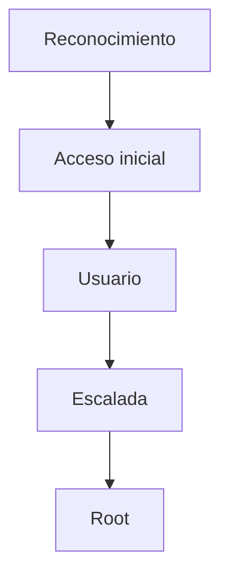

# {{Nombre}} — Roadmap

> [!abstract] Cadena de explotación
> Resumen en una línea de la kill chain.

## Diagrama



## Etapas

### 1. Reconocimiento
- **Objetivo:** 
- **Evidencia que permite avanzar:** 
- **Decisión / alternativa:** 

### 2. Acceso inicial
- **Objetivo:** 
- **Evidencia que permite avanzar:** 
- **Decisión / alternativa:** 

### 3. Usuario
- **Objetivo:** 
- **Evidencia que permite avanzar:** 
- **Decisión / alternativa:** 

### 4. Escalada a root
- **Objetivo:** 
- **Evidencia que permite avanzar:** 
- **Decisión / alternativa:** 

## Kill chain resumida

```text
recon → ... → user → ... → root
```

## Enlaces

- `{{Nombre}} - Walkthrough`
- `{{Nombre}} - Evidencias`
